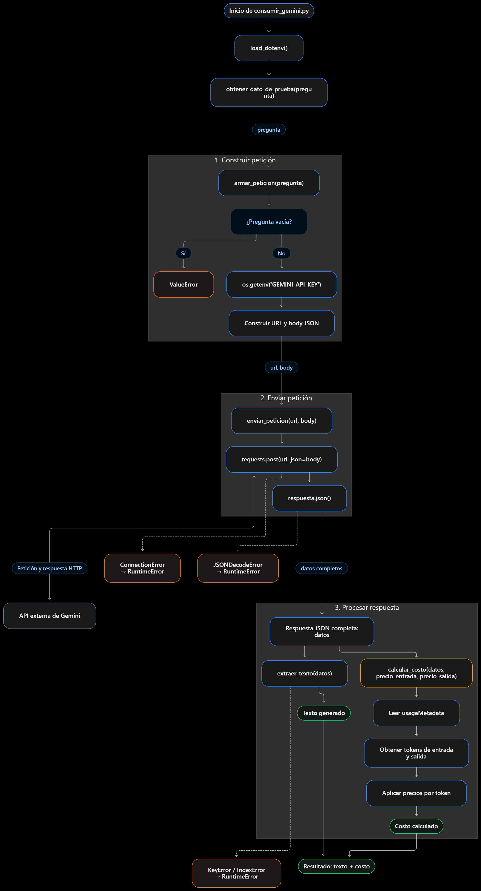

# Decisión de arquitectura: elección de modelo
  
 ## Modelo elegido
**Modelo C** (*gemini-3.5-flash-lite*), para la funcionalidad principal de la miniaplicación.

  
 ## Diagrama de arquitectura
 
  
El flujo comienza con la pregunta del usuario, que armar_peticion prepara y enviar_peticion envía a Gemini. La respuesta vuelve a la aplicación, donde se extrae el texto y se calculan su costo y latencia.

 ## Comparación de candidatos

| Criterio | Modelo A | Modelo B | Modelo C |
|---|---:|---:|---:|
| Nombre | gemini-3.8-flash | gemini-3.6-flash | gemini-3.5-flash-lite |
| Costo por tokens de entrada | 0.00000075 USD/token | 0.00000075 USD/token | 0.0000003 USD/token |
| Costo por tokens de salida | 0.00000375 USD/token | 0.00000375 USD/token | 0.0000025 USD/token |
| Latencia promedio observada | 26.29 s | 2.46 s | 2.18 s |
| Calidad de respuesta para el caso | Respondió correctamente | Respondió correctamente | Respondió correctamente |
| **Costo total de la última petición** | **0.000039 USD** | **0.000039 USD** | **0.000024 USD** |
| Fecha de medición | 20-10-2026 | 20-10-2026 | 20-10-2026 |

 ## Justificación

 Se eligió gemini-3.5-flash-lite porque respondió correctamente la consulta de prueba y obtuvo la menor latencia promedio (2,18 segundos) y el menor costo por petición (0,0000246 USD) entre los modelos evaluados. Como los otros modelos no mejoraron la respuesta en este caso, su mayor costo y tiempo de espera no se justifican para las necesidades de la aplicación. La elección prioriza una respuesta adecuada con menor costo y espera, según las mediciones realizadas.
  
 ## Alternativas descartadas y por qué

 Se descartaron gemini-3.8-flash y gemini-3.6-flash porque, aunque también respondieron correctamente, tuvieron un costo mayor por petición y una latencia promedio superior a gemini-3.5-flash-lite en las mediciones realizadas. Como no se observó una mejora en la respuesta para la consulta de prueba, no compensan su mayor costo y tiempo de espera para esta aplicación.